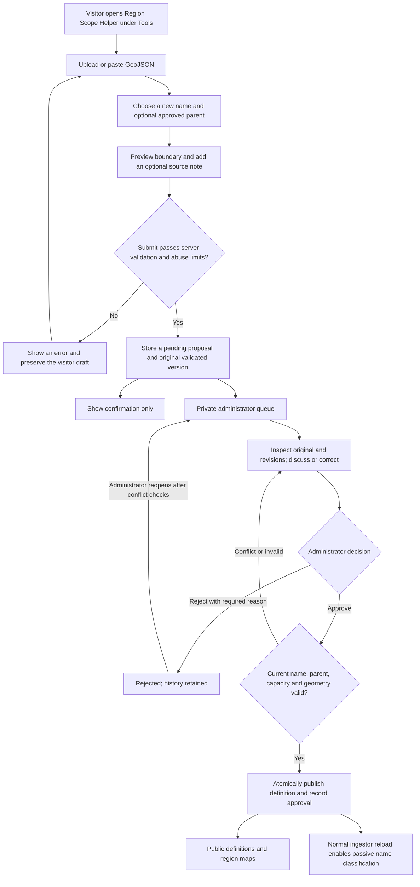

# Proposal: public region submissions and administrator review

> **Status: design review only — implementation has not started.**
> This change publishes a proposal, not a working feature. Product intent is
> agreed for this draft; maintainer feedback is requested before implementation.
> No application code, database migration, configuration, or deployment is changed.

## At a glance

Let a visitor propose a **new named hash region** using GeoJSON, preview its
boundary on the map, and submit it for private administrator review. Administrators
can discuss and correct the proposal, approve it, or reject it with a reason.
Keep the proposal's complete review history, with controlled redaction for
accidentally submitted sensitive information.

**Approval publishes a definition, not a routing instruction.** The approved name
joins CoreScope's existing passive packet-classification key set on its normal
reload. The polygon does not assign nodes by location, configure repeaters, or
change mesh routing. Pending and rejected proposals affect neither the published
region set nor packet classification.

### Where to give feedback

Use the draft PR conversation for overall design feedback, or leave a review
comment on a specific paragraph in this file. Start with
[Questions for maintainer review](#questions-for-maintainer-review). All UI and
workflow descriptions below are proposed behavior, not screenshots or evidence
of a live implementation.

## Proposed end-to-end workflow

The visitor does **not** get a public tracking link, account, contact request,
approval notification, or access to the private queue. Discussion is between
administrators, not a visitor messaging system.

## Visitor experience

1. **Discover the form.** Keep it inside the existing Region Scope Helper under
   Tools, with an entry link from Regions. Do not create another top-level tab.
2. **Provide the region.** Upload a GeoJSON file or paste GeoJSON. Enter a new
   hash-region name, optionally choose an existing approved parent, and optionally
   add a short explanation or boundary-source note. Do not collect contact details.
3. **Inspect the exact candidate.** Show the parsed Polygon or MultiPolygon on a
   map, existing approved boundaries for orientation, the proposed name, and the
   explicit parent. File upload and paste must use the same parsing/preview path.
4. **Confirm and submit.** Validate again on the server. Show useful errors without
   discarding the local draft. On success, state that the proposal is pending
   administrator review, not approved or already active.

Only new definitions may be proposed in v1. Visitors cannot modify an approved
region or amend a stored proposal after submission. Existing approved definitions
remain publicly readable; submitted proposals do not become a public listing.

### Names, hierarchy, and boundaries

- Use the existing hash-name normalization and uniqueness rules. A name already
  approved or pending cannot be proposed again. A rejected name may be proposed
  again, subject to the same current checks and limits.
- Store an explicit optional parent selected from approved definitions. Never
  infer parentage from the spelling of a name or require a polygon to nest inside
  its parent's boundary unless a separate product decision introduces that rule.
- Accept supported GeoJSON Polygon/MultiPolygon input and existing supported
  Feature/FeatureCollection wrappers. Preserve every supported polygon and hole.
  Strip unrelated Feature properties and raw source text before permanent storage.
- Reject malformed coordinates, null ordinates, non-polygon input, invalid
  topology, excessive shape size/work, and positive-area overlap between members
  of one proposed MultiPolygon. Preserve the canonical validator's treatment of
  shared edges and point touching.
- Different named regions may overlap or have identical boundaries. Their
  existence does not imply geographically assigned node membership.

## Private administrator review

Extend the existing hash-region administration area with a pending count and a
paginated review queue. Keep the normal approved-region editor available.

A review shows the original validated submission, the latest candidate, a map
comparison with approved boundaries, all revisions, and attributed administrator
comments and decisions. An administrator may correct the name, parent,
note/description, or geometry; each correction creates a new historical version.
Discussion is optional, and **one authenticated administrator may approve**.

| Action | Proposed result | Required protection |
| --- | --- | --- |
| Comment or correct | Append a comment or candidate revision | Authentication, CSRF, bounded input, and conflict detection |
| Approve | Publish exactly one approved definition and record the decision atomically | Recheck the latest candidate, current name/parent, definition capacity, and current approved set |
| Reject | Retain the proposal with a required administrator-written reason | Reason stays in private history; no visitor notification |
| Reopen | Return a rejected proposal to review without erasing the rejection | Check current name conflicts, pending capacity, and any replacement proposal |
| Redact sensitive content | Mask the affected content while retaining a redaction event | Narrow authorization; no ordinary history rewrite or public exposure |

Approval must be retry-safe: a lost response or repeated click cannot insert a
second definition or duplicate the decision. Concurrent corrections, comments,
and approvals must not silently overwrite or approve a stale candidate. A parent
removed or renamed during review must produce a useful conflict, not an orphan.
The definition-count limit must be enforced inside the approval transaction.

A replacement submission using a previously rejected name must not create two
active pending candidates if an administrator later reopens the old proposal.
The precise conflict message and recovery interaction remain implementation design
work; silently publishing the wrong version is not acceptable.

## Permanent history and privacy boundary

Retain the original validated fields and geometry, every candidate revision,
administrator attribution, timestamps, comments, rejection reasons, decisions,
reopenings, and redaction events. There is no automatic time-based history purge.
This proposal covers the lifecycle through publication; it does **not** create an
audit system for unrelated later edits through the ordinary region editor.

Do not retain visitor IP addresses, browser fingerprints, credentials, raw upload
bytes, or unrelated GeoJSON properties **as proposal history**. Any abuse-control
identifier must be minimal and short-lived. This is not a claim that existing
infrastructure or access logs already meet that policy; review those boundaries
before implementation and avoid introducing new persistent visitor identifiers.

Warn visitors not to include personal information or secrets in notes or files.
Controlled redaction is the exception to content retention: keep an event stating
that content was redacted, not the sensitive value in an ordinary revision or
comment. Define the backup/redaction recovery policy before shipping so restoring
a backup does not silently undo a redaction.

Permanent storage requires capacity planning and backup/restore coverage. Keep
runtime collections and administrator responses bounded and paginated; permanent
history does not authorize loading every event into memory or unlimited anonymous
pending submissions.

## Architecture and trust boundaries

These anchors were checked against source baseline
`652a8b25816b7b5d62ea46c9d2e9880e100b7ce1`. Recheck the then-current source before
implementation; this is not a frozen endpoint or schema specification.

| Area | Existing anchor | Proposed use or constraint |
| --- | --- | --- |
| Public entry and map | [`public/region-scope.js`](../../public/region-scope.js), [`public/region-scope-helpers.js`](../../public/region-scope-helpers.js), [`public/regions.js`](../../public/regions.js) | Reuse the Tools child route, parsing helpers, map conventions, and approved definitions |
| Administrator UI | [`public/admin/hash-regions.html`](../../public/admin/hash-regions.html), [`public/admin/hash-regions.js`](../../public/admin/hash-regions.js) | Add a review queue alongside the approved-definition editor |
| Routes and authentication | [`cmd/server/routes.go`](../../cmd/server/routes.go), [`cmd/server/admin_auth.go`](../../cmd/server/admin_auth.go) | Separate bounded anonymous submission from authenticated, CSRF-protected review; register route metadata |
| Canonical validation | [`cmd/server/hash_region_definitions.go`](../../cmd/server/hash_region_definitions.go) | Reuse name, hierarchy, geometry, and aggregate work protections; do not create a weaker proposal validator |
| Durable administration | [`internal/admindb/admindb.go`](../../internal/admindb/admindb.go) | Store proposals/events in the administration database; use atomic approval and optimistic conflict checks |
| Passive classification | [`cmd/ingestor/main.go`](../../cmd/ingestor/main.go) | Only approved names enter the existing region-key reload path |
| Execution policy | [`AGENTS.md`](../../AGENTS.md), [`tests/manifest.json`](../../tests/manifest.json), [agent workflow](../agents/WORKFLOW.md) | Follow current test-first, security, browser, and active-test registration rules |

The server's **packet database remains read-only**. Server-owned administration
storage already supports writes; proposal/event tables belong there, not in the
packet database. The ingestor remains the packet-data writer.

The baseline currently caps approved definitions at 100 and names at 64
characters, and the administrator replacement route has a 1 MiB request cap.
These are existing constraints to recheck, not newly implemented proposal limits.
Choose and document explicit submission-byte, geometry-work, pending-count,
rate-limit, note/comment, and page-size limits before coding. Keep any future
operator-configurable limits on the configuration/customizer follow-up ledger;
this documentation change adds no configuration fields.

Additional security requirements:

- Rate-limit and cap request bytes before expensive geometry work. Bound every
  validation phase and the aggregate work; a byte cap alone is not a CPU bound.
- Validate a proposed child against the **current stored approved parent set**,
  not only a one-item new-definition list. Recheck parent/name/capacity atomically
  at approval and preserve unrelated concurrent approved-region changes.
- Do not expose pending/rejected proposals, review comments, administrator
  identity, or private event history through public APIs. A guessed identifier
  must not grant access. Avoid logging submitted content as diagnostics.
- Preserve abuse limits for already-tracked sources when the limiter is full;
  avoid evicting a live entry merely to admit a new source. Define bounded,
  retry-safe submission behavior without a visitor edit credential or tracking URL.
- Keep approved-boundary rendering separate from observed relay evidence.
  No inferred relay hull becomes an administrative boundary through this workflow.

## Proposed implementation milestones — not started

Each milestone needs a source-fresh plan and explicit implementation authorization.
The checkboxes below describe future acceptance, not work completed by this PR.

- [ ] **Storage and submission:** proposal/event migrations in administration
  storage; bounded anonymous intake; canonical GeoJSON validation; uniqueness,
  parent, abuse-limit, and retry behavior. Tests cover rejection without writes,
  duplicate/racing submissions, and migration/backup compatibility.
- [ ] **Moderation and atomic publication:** authenticated queue, revision/comment
  concurrency, correction/rejection/reopen/redaction, retry-safe approval, and
  current-set/capacity checks. Tests cover unauthorized access, CSRF, stale
  candidates, changed parents, replacement submissions, and transaction rollback.
- [ ] **Visitor form and map:** shared upload/paste preview, explicit confirmation,
  orientation boundaries, and Regions entry link. Browser tests cover desktop,
  mobile, keyboard access, errors, and preservation of the local draft.
- [ ] **Administrator review interface:** pending count, paginated queue, exact
  geometry comparison, attributed history, and ordinary editor compatibility.
  Browser tests cover review transitions, competing edits, and private visibility.
- [ ] **Integration and release evidence:** verify public definition/map visibility
  only after approval; prove approved-name reload versus pending/rejected isolation;
  run active canonical suites, module-local race/static checks, security and
  test-quality reviews, browser acceptance, and exact-head CI before release.

### Acceptance checklist for the eventual feature

| Boundary | Evidence required |
| --- | --- |
| Public intake | Valid Polygon/MultiPolygon upload and paste; preserved holes/members; optional parent/note; exact preview and pending confirmation; malformed/null/oversized/non-polygon/invalid-topology rejection without storing a proposal |
| Private review | No anonymous history access; required rejection reason; attributed revisions/comments; safe reopen/redaction; one administrator can approve; concurrent edits conflict rather than disappear |
| Atomic publication | Retry-safe single insertion; parent/name/capacity rechecked against current state; no unrelated definition lost; approved definition readable in public APIs and both region map surfaces |
| Packet and mesh semantics | Pending/rejected names never enter classification; approved names use the normal reload; no spatial node assignment, routing change, or firmware configuration |
| Safety and operation | Bounded request/CPU/memory/display work; saturated limiter behavior; accessible desktop/mobile flows; consistent backup/restore/redaction policy; active regression registration and independent exact-head review |

## Questions for maintainer review

The following are requests for feedback, not permission to begin implementation.
Please flag changes to the proposed v1 scope explicitly.

1. **Product fit:** does public intake inside Tools → Region Scope Helper, linked
   from Regions, fit the intended user workflow without adding another top-level tab?
2. **Moderation:** is confirmation-only visitor UX plus private administrator
   discussion, one-person approval, and a required rejection reason the right v1?
3. **Data and concurrency:** are administration-database proposal/event tables,
   permanent lifecycle history, controlled redaction, and atomic publication the
   right boundaries? What backup/redaction policy should be required?
4. **Abuse and capacity:** which explicit body/work/pending/rate/page limits and
   retry semantics should be approved before implementation? Is the reopening
   conflict behavior sufficient when a rejected name has been resubmitted?
5. **Implementation sequence:** are the five slices above appropriately scoped,
   and are there existing maintainership or architecture constraints to address
   before defining routes, schema, and tests?

## Deliberate non-goals

No visitor accounts, contact details, public proposal listing/status tracking,
visitor amendments, external notifications, CAPTCHA, public discussion, or
visitor edits to approved regions. No automatic approval, polygon-based node
assignment, mesh routing changes, repeater commands, or general audit trail for
later unrelated approved-region edits. No feature implementation, merge,
deployment, or independent proposal website is authorized by this draft PR.
